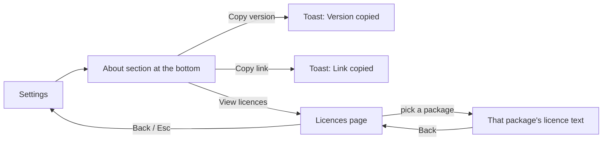

# About and licences — UI spec

Date: 2026-11-19 (revised 2026-11-22: licence list order and the hidden duplicate row, PM decisions in `docs/status.md`) — Design note: `docs/design/signed-installers-and-beta.md` (M1.9a) — Status: draft, waiting for PM

## User and task

- **User:** a beta tester, or anyone who installs Kusunga.
- **Task:**
  - see which version they run, so they can report it;
  - read the licence and the third-party notices;
  - find the source code.
- **Success:**
  - a tester can name the exact version and build in under 10 seconds;
  - every notice listed in `docs/licences.md` is reachable in the app (checked by a test);
  - the source link matches the tag of the running build.

## Flow



There is no network use: Kusunga does not open a browser. The source link is shown as text with a Copy link button, so no new dependency or entitlement is needed.

## Layout

The new section goes at the bottom of Settings, after "Your data", using the existing `SectionHeading` and `space5` gap:

```
About
Kusunga 0.9.0 (build 1)                [Copy version]
Copyright (C) 2026 William Nasoni
Kusunga is free software under the GNU General Public License,
version 3 only. It comes with NO WARRANTY.
Source code: https://github.com/Thamzy265/kusunga/tree/v0.9.0
                                        [Copy link]
[View licences]
```

- **Version line:** the version and build come from the running app (`package_info` is not used; the version is put in at build time with `--dart-define` or read from the platform bundle; the developer picks the simpler one and says which).
- **Source link:** points to the tag `v<version>`. A debug or profile build shows the branch-free link `https://github.com/Thamzy265/kusunga` and the caption "Development build".
- **Licences page:**
  - Flutter's `LicensePage`, opened with `showLicensePage`;
  - `applicationName` "Kusunga", `applicationVersion` as above, `applicationLegalese` = the copyright and GPL sentence.
- **Notices added with `LicenseRegistry.addLicense`:**
  - "Kusunga": the full GPL-3.0 text from `LICENSE`;
  - "SQLite3 Multiple Ciphers": its MIT licence, plus the notice for each bundled part listed in `docs/licences.md` (AEGIS, Ascon, ChaCha20/Poly1305, SHA-1/2, MD5, fastpbkdf2, Argon2, AES, miniz, and the inferred-MIT files). Each text is copied word for word from the project at tag v2.5.0, with the file and lines named (only the comment marks at the start of lines, and decorative lines made only of comment characters, are left out). The files name CC0 1.0 and Apache 2.0 by address and do not contain those two texts.
  - "SQLite": the public-domain blessing.
  - The texts are bundled as assets, never fetched.

## States matrix

| Screen / component | Default | Hover | Focus | Disabled | Loading | Empty | Error | Success | Long content | Offline | Permission denied |
|---|---|---|---|---|---|---|---|---|---|---|---|
| About section | Heading, version line, copyright, GPL sentence, source link, three buttons | Buttons use `surfaceHover` | Visible `focus` ring on each button | n/a — nothing is ever disabled | n/a — all text is local and ready at build time | n/a — always has content | Version unknown (should not happen): shows "Kusunga (version unknown)"; Copy version copies that text | n/a | Text wraps; the link wraps at `/` characters; no truncation | Same as default; no network used | n/a — no permission needed |
| Copy version button | "Copy version" | `surfaceHover` | Focus ring | n/a | n/a | n/a | Clipboard write fails: toast "Couldn't copy. Try again." | Toast "Version copied" | n/a | Same | n/a |
| Copy link button | "Copy link" | `surfaceHover` | Focus ring | n/a | n/a | n/a | Toast "Couldn't copy. Try again." | Toast "Link copied" | n/a | Same | n/a |
| View licences button | "View licences" | `surfaceHover` | Focus ring | n/a | n/a | n/a | n/a | Opens the licences page | n/a | Same | n/a |
| Licences page (Flutter `LicensePage`) | Package list: "Kusunga" first (pinned), then Flutter's collected notices with "SQLite" and "SQLite3 Multiple Ciphers" sorted in by name; both are also inside Kusunga's entry. Flutter's own copy of the app licence (the lower-case "kusunga" row) is hidden | List rows highlight | Focus moves to the first row; Back is reachable by Tab and Esc | n/a | Flutter shows its own spinner while notices load (under 1 s) | n/a — never empty | n/a | n/a | Long licence texts scroll; text reflows | Same — all local | n/a |

Copying the version or link puts it on the clipboard. Whether that copy goes into Kusunga's own history follows the existing rule for Kusunga's own copies. The developer confirms the rule and says so in the hand-off; no new rule.

## Breakpoints

- **320 px** (stand-in: 360 px window at 200% text): the buttons stack one per row, below their text; the link wraps. No sideways scrolling.
- **360–599 px:** Copy version and Copy link sit under their lines; View licences is on its own row.
- **≥ 600 px:** the layout above, with buttons at the end of their lines.
- **Licences page:** Flutter's `LicensePage` already has two layouts. Under 840 px it shows the list and the detail one at a time; at 840 px and wider, side by side. Both are checked at 320 px.

## Accessibility notes

- **Headings and landmarks:** "About" is a heading, like the other sections (`SectionHeading`). The licences page has its own title.
- **Focus order and keyboard paths:** Copy version, Copy link, View licences, in reading order. Esc or Back on the licences page returns focus to "View licences". Nothing covers the focused element. Toasts appear at the bottom and do not take focus.
- **Accessible names:** "Copy version" and "Copy link" have semantics labels that say what they copy: "Copy version 0.9.0 build 1" and "Copy source code link". The link text is selectable.
- **Live region:** toasts are announced, using the existing toast behaviour.
- **Targets:** at least 24 × 24 px. Existing tokens only. Contrast: text 4.5:1, controls 3:1, in light and dark.
- **Motion:** the page transition follows the existing `prefers-reduced-motion` handling.

## Copy

- Heading: "About"
- Version: "Kusunga <version> (build <n>)" — debug/profile adds " — development build"
- Copyright: "Copyright (C) 2026 William Nasoni"
- Licence sentence: "Kusunga is free software under the GNU General Public License, version 3 only. It comes with NO WARRANTY."
- Source: "Source code: <link>"
- Buttons: "Copy version", "Copy link", "View licences"
- Toasts: "Version copied", "Link copied", "Couldn't copy. Try again."
- Licence page legalese: "Copyright (C) 2026 William Nasoni. Licensed under the GNU GPL, version 3 only. This program comes with ABSOLUTELY NO WARRANTY. This is free software, and you are welcome to redistribute it under certain conditions; see the GNU GPL for details." (the GPL's own interactive notice, section "How to Apply These Terms")

## Tokens used

Existing tokens only: `surface`, `surfaceHover`, `text`, `textMuted`, `focus`, `space1`–`space5`, `body`, `caption`, `title`. No new tokens.
