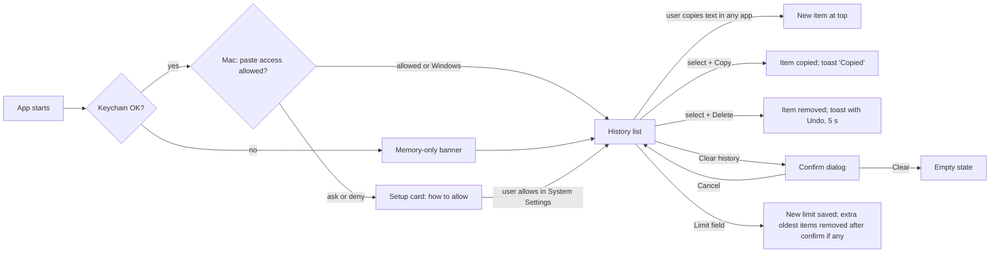

# M1.2 History list (main window) — UI spec

Date: 2026-11-03 — Design note: `docs/design/clipboard-history.md` — Status: draft, waiting for PM

## User and task

- User: someone who copies a lot on Mac or Windows.
- Task: see what Kusunga has saved, copy an item again, delete an item, clear history, set how many items to keep.
- Success: QA can see a copied item appear within 1 second; delete and clear work in one action each with undo or confirm; every action works with keyboard only and with VoiceOver / Narrator.

The fast "shortcut picker" that pastes into other apps is M1.3. This window is the home view and the place to manage history.

## Flow



## Layout (desktop window, default 800×632, min 360×400)

```
┌ Kusunga ───────────────────────────────────────────┐
│ History                     Keep [ 200 ] items  ⋯  │  ⋯ = menu: Clear history
│ ┌────────────────────────────────────────────────┐ │
│ │ [banner / setup card when needed]              │ │
│ ├────────────────────────────────────────────────┤ │
│ │ 🔗 https://example.com/very/long/link…   2 min  │ │  row: icon, 2 lines max, time
│ │ T  Call me on 07700 900123 when you…     5 min  │ │  row actions on hover/focus:
│ │ T  Meeting notes: agenda for Thursday…   1 h    │ │  [Copy] [Delete]
│ └────────────────────────────────────────────────┘ │
│ 3 of 200 items                                      │
└─────────────────────────────────────────────────────┘
```

## States matrix

| Screen / component | Default | Hover | Focus | Disabled | Loading | Empty | Error | Success | Long content | Offline | Permission denied |
|---|---|---|---|---|---|---|---|---|---|---|---|
| History list | Newest first; each row: kind icon, first 2 lines of text, relative time | Row background `color.surface.hover`; Copy and Delete buttons show | Same as hover plus 2 px focus ring `color.focus`; Up/Down move, Enter copies, Delete/Backspace deletes | n/a — list is never disabled | Spinner with "Opening your history…" while the DB opens (only if > 300 ms) | Icon + "Nothing here yet" + "Copy some text in any app and it will appear here." | Error banner (see Banner row); list still shows in-memory items | New item slides in at top (no motion if reduced motion) | Truncated to 2 lines with "…"; full text in tooltip and in the accessible name (first 500 characters) | n/a — no network | Mac paste access not allowed: setup card above an empty list |
| Row actions (Copy, Delete) | Hidden | Shown | Shown, each focusable with Tab | n/a | n/a | n/a | Copy fails: toast "Couldn't copy. Try again." | Copy: toast "Copied". Delete: toast "Deleted" + Undo (5 s) | n/a | n/a | n/a |
| "Keep N items" field | Number field showing current limit | Border `color.border.hover` | Focus ring; Up/Down change by 10 | n/a | n/a | n/a | Out of range: "Enter a number from 10 to 5,000." under the field, linked by `aria-describedby`; value not saved | Saved on Enter or blur; if new limit is below the current count: confirm "Keep only the newest N items? X older items will be deleted." [Delete X items] [Cancel] | n/a | n/a | n/a |
| Menu ⋯ → Clear history | Menu item | Highlight | Focus ring | Disabled when list is empty | n/a | Disabled | Clear fails: banner "Couldn't clear history. Try again." | Confirm dialog: "Clear all history? This deletes all N items. Snippets are not affected." [Clear history] [Cancel] → empty state | n/a | n/a | n/a |
| Banner (memory-only, read error, write error) | Hidden | n/a | Banner text is focusable and announced (live region, polite) | n/a | n/a | n/a | Memory-only: "History won't be kept after you quit, because Kusunga can't reach your keychain." Read error: "Kusunga couldn't read your old history, so it started a new one." Write error: "Couldn't save the latest item. Kusunga will try again." | Dismiss button (×) | Wraps | n/a | n/a |
| Setup card (Mac paste access) | Hidden | n/a | Focus moves to the card's heading on show | n/a | n/a | n/a | n/a | Disappears on next launch once allowed | Wraps | n/a | "Allow Kusunga to read what you copy" + "To keep your history, open System Settings > Privacy & Security > Paste from Other Apps and choose Allow for Kusunga." + [I've done this] (re-checks) |
| Footer count | "N of LIMIT items" | n/a | Not focusable; read as status | n/a | n/a | "0 of LIMIT items" | n/a | Updates as items change (polite live region, throttled to once per 2 s) | n/a | n/a | n/a |

## Breakpoints

- Window min width 360 px (desktop; 320 px reflow rule applied as: at 360 px the header wraps to two lines — "History" then the limit field and ⋯; rows drop the time to a second line; no sideways scrolling).
- 360–599 px: one column, header wraps as above.
- ≥ 600 px: header on one line, time aligned right.
- Text scale 200%: rows grow in height, header wraps; nothing clipped.

## Accessibility notes

- Headings and landmarks: window title "Kusunga"; heading "History" (level 1); list has the accessible label "Clipboard history, N items".
- Focus order: header (limit field → ⋯ menu) → banner/setup card if present → list → footer. On first launch focus starts on the list (or the setup card if shown). Nothing covers the focused element; toasts appear at the bottom and never over the focused row (WCAG 2.4.11).
- Keyboard: Up/Down move in the list; Home/End jump; Enter copies; Delete/Backspace deletes; Cmd/Ctrl+Z undoes the last delete while the toast shows; Esc closes menus and dialogs and returns focus to the control that opened them.
- Accessible names: each row "Link: https://example.com…, copied 2 minutes ago" or "Text: Call me on…, copied 5 minutes ago"; buttons "Copy" and "Delete" with the row text in their description.
- Form labels: the limit field has the visible label "Keep" … "items" and the accessible name "Number of history items to keep"; the error is linked by `aria-describedby` (Flutter `Semantics` hint).
- Targets: all buttons at least 24×24 px; row height at least 44 px.
- Motion: new-item slide-in is off when the OS "reduce motion" setting is on.
- Contrast: 4.5:1 for text, 3:1 for icons, borders and the focus ring, in light and dark.
- Bidi and control characters in content are shown as visible symbols so text cannot pretend to be something else.

## Copy

- Heading: "History"
- Limit: "Keep [N] items"; error "Enter a number from 10 to 5,000."; confirm "Keep only the newest N items? X older items will be deleted." buttons "Delete X items", "Cancel"
- Empty: "Nothing here yet" / "Copy some text in any app and it will appear here."
- Row buttons: "Copy", "Delete"; toasts "Copied", "Deleted" + "Undo", "Couldn't copy. Try again."
- Clear: menu "Clear history"; dialog "Clear all history?" / "This deletes all N items. Snippets are not affected." buttons "Clear history", "Cancel"
- Banners: as in the states matrix.
- Setup card: as in the states matrix.
- Footer: "N of LIMIT items"

No deceptive patterns: "Cancel" is never styled to look like the destructive action; delete has Undo; clear has a confirm.

## Tokens used

Semantic tokens only, defined once in `lib/theme/tokens.dart` with light and dark values: `color.surface`, `color.surface.hover`, `color.text`, `color.text.muted`, `color.border`, `color.border.hover`, `color.focus`, `color.danger`, `color.banner.warn.bg`, `color.banner.warn.text`, `space.1`–`space.6` (4 px steps), `radius.2`, `type.body`, `type.caption`, `type.title`. No hard-coded colours or sizes in widgets.
