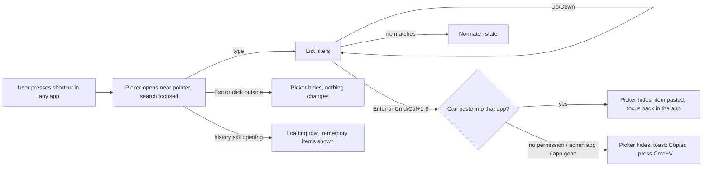

# M1.3 History picker — UI spec

Date: 2026-11-04 — Design note: `docs/design/history-picker.md` — Status: approved by PM 2026-11-04

## User and task

- User: someone typing in any app who wants to paste something they copied earlier.
- Task: press the shortcut, find the item by typing a few letters, press Enter, keep typing in their app.
- Success: shortcut → pasted in under 3 seconds for a known item; zero pastes into the wrong app; every step works with keyboard only and with VoiceOver / Narrator.

## Flow



## Layout (borderless panel, 560 × 420, min 360 × 240; centred horizontally on the screen with the pointer, top third)

```
┌──────────────────────────────────────────────────────┐
│ 🔍 [ Search history…                             ]   │
│ ──────────────────────────────────────────────────── │
│ ▶ 1  T  Call me on 07700 900123 when you…    2 min   │  selected row
│   2  🔗 https://example.com/very/long/link…   5 min   │
│   3  T  Meeting notes: agenda for Thursday…   1 h    │
│ …                                                    │
│ ──────────────────────────────────────────────────── │
│ ↵ Paste   ⌘1–9 Quick paste   esc Close     12 items  │
└──────────────────────────────────────────────────────┘
```

## States matrix

| Screen / component | Default | Hover | Focus | Disabled | Loading | Empty | Error | Success | Long content | Offline | Permission denied |
|---|---|---|---|---|---|---|---|---|---|---|---|
| Picker panel | Opens with search focused and the first row selected; shows newest 50 rows (scroll for more) | n/a | Focus stays in the search field; Up/Down move the selection, not the focus | n/a | History opening: one row "Opening your history…" above any in-memory items | "Nothing here yet" / "Copy some text in any app and it will appear here." | Shortcut failed to register: picker can still be opened from the tray menu "Open picker" | Hides; target app has focus | Rows one line, ellipsis; full text never shown in the picker (privacy) | n/a — no network | n/a for the panel (see toast) |
| Search field | Placeholder "Search history…" | Border `color.border.hover` | 2 px focus ring `color.focus` | n/a | n/a | n/a | n/a | n/a | Long queries scroll inside the field | n/a | n/a |
| Result row | Number 1–9 for the first nine, kind icon, one line of text, relative time | Background `color.surface.hover` | Selected row: background `color.selection`, left marker ▶ (not colour alone) | n/a | n/a | n/a | n/a | n/a | Ellipsis; matches highlighted with bold + underline (not colour alone) | n/a | n/a |
| No-match | n/a | n/a | n/a | n/a | n/a | "No matches for "<query>"" / "Try fewer letters." | n/a | n/a | Query shown truncated to 40 characters | n/a | n/a |
| Toast "Copied — press ⌘V to paste" | Hidden | n/a | Announced (live region, assertive) | n/a | n/a | n/a | Variants: no permission (Mac), admin app (Windows "Copied — press Ctrl+V to paste. Kusunga can't paste into apps run as administrator."), app gone | n/a | n/a | n/a | Mac: "Copied — press ⌘V to paste. Allow pasting in Kusunga to do this for you." |
| Permission card (main window, Mac) | Hidden until a paste needed the permission | n/a | Focus moves to its heading when shown | n/a | n/a | n/a | n/a | Disappears once allowed | Wraps | n/a | "Let Kusunga paste for you" / "To paste into other apps, Kusunga needs permission to send the ⌘V keystroke. It never reads what's on your screen." / [Allow pasting] (asks macOS) / [Not now] |
| Shortcut setting (main window) | "Picker shortcut: ⌘⇧V" + [Change] | Border hover | Focus ring | n/a | "Press the new shortcut…" while recording | n/a | "That shortcut is used by another app. Choose another." / "Use at least one of ⌘, ⌃ or ⌥ with a key." | "Shortcut saved" | n/a | n/a | n/a |

## Breakpoints

- Picker: fixed 560 px wide on screens ≥ 800 px; on smaller screens (or 200% text) width = 90% of the screen, min 360 px; rows keep one line with ellipsis; footer hints wrap to two lines at < 480 px. No sideways scrolling.
- Main window additions (shortcut setting, permission card) follow the M1.2 breakpoints (360 px minimum).

## Accessibility notes

- Panel role: dialog with the name "Kusunga picker"; VoiceOver/Narrator announce "Kusunga picker. Search history. 12 items."
- Search field: accessible name "Search history"; the result count is a polite live region ("3 matches"), throttled to once per 500 ms.
- Rows: accessible name "1, Text: Call me on…, copied 2 minutes ago"; the selected row is exposed as selected (`Semantics(selected: true)`), and selection changes are announced.
- Keyboard: Up/Down, Home/End, Page Up/Down move the selection; Enter pastes; Cmd/Ctrl+1–9 paste that row; Esc closes; Tab does nothing that leaves the panel (focus trap), Shift+Tab likewise. Nothing covers the focused field or the selected row (WCAG 2.4.11).
- Mouse: click a row to paste; click outside or deactivate to close.
- Targets: rows at least 32 px high (desktop), buttons 24 × 24 px minimum.
- Motion: panel appears without animation if reduce motion is on; otherwise a 100 ms fade.
- Contrast: 4.5:1 text, 3:1 selection background and focus ring, light and dark.
- Selection is never shown by colour alone (▶ marker and bold).

## Copy

- Search placeholder: "Search history…"
- Footer: "↵ Paste", "⌘1–9 Quick paste" (Windows "Ctrl+1–9 Quick paste"), "esc Close", "N items" / "N matches"
- No match: "No matches for "<query>"" / "Try fewer letters."
- Empty / loading: as in the states matrix (shared with M1.2).
- Toasts: "Copied — press ⌘V to paste." ; "Copied — press ⌘V to paste. Allow pasting in Kusunga to do this for you." ; "Copied — press Ctrl+V to paste. Kusunga can't paste into apps run as administrator."
- Permission card: heading "Let Kusunga paste for you"; body "To paste into other apps, Kusunga needs permission to send the ⌘V keystroke. It never reads what's on your screen."; buttons "Allow pasting", "Not now"; after "Allow pasting" macOS shows its own dialog; then "Turn on Kusunga in System Settings > Privacy & Security > Accessibility." (Apple lists this permission under Accessibility.)
- Shortcut setting: "Picker shortcut", "Change", "Press the new shortcut…", "Shortcut saved", "That shortcut is used by another app. Choose another.", "Use at least one of ⌘, ⌃ or ⌥ with a key." (Windows: "Use at least one of Ctrl, Alt or Win with a key.")
- Tray menu: new item "Open picker" above "Open Kusunga".

No deceptive patterns: "Not now" is as easy as "Allow pasting"; Kusunga never asks for the permission on its own.

## Tokens used

Existing tokens from `lib/theme/tokens.dart` plus one new semantic token `color.selection` (light and dark, 3:1 against `color.surface`). No hard-coded values.
