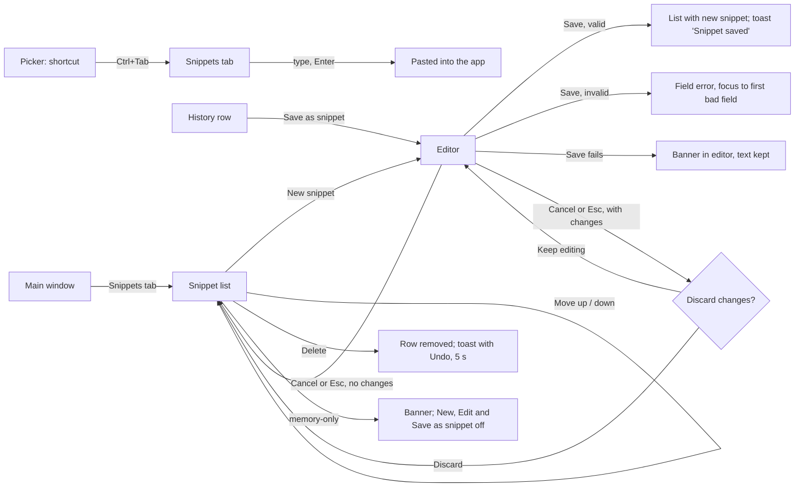

# M1.4 Saved snippets — UI spec

Date: 2026-11-04 — Design note: `docs/design/saved-snippets.md` — Status: approved by PM 2026-11-04

## User and task

- User: someone who pastes the same few things often, such as their phone number, email address, home address or a meeting link.
- Tasks:
  - Save a snippet once, either new or from a history item.
  - Find it again in the picker and paste it with a few keys.
  - Keep the list in their own order.
  - Fix or delete a snippet.
- Success:
  - Saving a new snippet takes under 20 seconds.
  - A known snippet is pasted in under 3 seconds from the shortcut.
  - Reordering works without a mouse.
  - Every action works with keyboard only and with VoiceOver and Narrator.

## Flow



## Layout

Main window, Snippets tab (the window size is unchanged: 800 × 632, min 360 × 400):

```
┌ Kusunga ───────────────────────────────────────────┐
│ [ History ] [ Snippets ]              [+ New snippet]│
│ ┌────────────────────────────────────────────────┐ │
│ │ ☎  My mobile        07700 900123               │ │ row actions on hover/focus:
│ │ ✉  Work email       will@example.com           │ │ [Copy] [Edit] [↑] [↓] [Delete]
│ │ 🔗 Zoom room        https://zoom.us/j/12345…    │ │
│ │ ⌂  Home address     1 High Street, London…     │ │
│ └────────────────────────────────────────────────┘ │
│ 4 snippets                                          │
└─────────────────────────────────────────────────────┘
```

Editor (a sheet over the window; a full-window view under 480 px):

```
┌ New snippet ───────────────────────────────┐
│ Name     [ My mobile                     ] │
│ Type     [ Phone ▾ ]   (suggested)         │
│ Content  ┌───────────────────────────────┐ │
│          │ 07700 900123                  │ │
│          └───────────────────────────────┘ │
│ For bank or card details, wait for the     │  (D4 option A)
│ secure vault in a later update.            │
│                         [Cancel]  [Save]   │
└────────────────────────────────────────────┘
```

Picker with tabs (the same 560 × 420 panel as M1.3):

```
┌──────────────────────────────────────────────────────┐
│ [ History ] [ Snippets ]                             │
│ 🔍 [ Search snippets…                            ]   │
│ ▶ 1  ☎  My mobile — 07700 900123                     │
│   2  ✉  Work email — will@example.com                │
│ ↵ Paste  ⌘1–9 Quick paste  ⌃Tab Switch  esc Close  4 │
└──────────────────────────────────────────────────────┘
```

## States matrix

| Screen / component | Default | Hover | Focus | Disabled | Loading | Empty | Error | Success | Long content | Offline | Permission denied |
|---|---|---|---|---|---|---|---|---|---|---|---|
| Main window tabs (History, Snippets) | History selected at start | Background `color.surface.hover` | 2 px focus ring `color.focus`; Left/Right move between tabs (tablist pattern); the selected tab is underlined and bold, not colour alone | n/a | n/a | n/a | n/a | n/a | n/a | n/a — no network | n/a |
| Snippet list | The user's order. Each row: type icon, name (bold), one line of content, relative "edited" time on wide windows | Row `color.surface.hover`; actions show | Like hover, plus a focus ring. Up/Down move, Enter copies, ⌥↑/⌥↓ (Windows Alt+↑/↓) move the snippet, E or F2 edits, Delete/Backspace deletes | n/a | "Opening your snippets…" while the database opens (only if > 300 ms) | Icon + "No snippets yet" / "Save things you paste often, like your phone number or email." / [New snippet] | Read fails: banner "Kusunga couldn't read your snippets. Try again." [Try again] | n/a | Name and content cut with an ellipsis on one line; the full text is in the editor | n/a | n/a |
| Row actions (Copy, Edit, Move up, Move down, Delete) | Hidden | Shown | Each focusable with Tab; Move up is hidden on the first row and Move down on the last | Off in memory-only mode (Copy still works) | n/a | n/a | Move or delete fails: toast "Couldn't move the snippet. Try again." / "Couldn't delete the snippet. Try again." | Copy: toast "Copied". Move: focus stays on the moved row, announced "My mobile, moved to position 2 of 4". Delete: toast "Snippet deleted" + Undo (5 s) | n/a | n/a | n/a |
| New snippet button | Shown top right | Hover background | Focus ring | Off in memory-only mode and at 1,000 snippets; the reason is shown as text next to it, not only in a tooltip | n/a | Also shown inside the empty state | n/a | Opens the editor | n/a | n/a | n/a |
| Editor (new, edit, from history) | Title "New snippet" / "Edit snippet". Fields: Name, Type, Content. Focus in Name (in Content when created from history) | Field border `color.border.hover` | Focus ring on the focused field; Tab order Name → Type → Content → Cancel → Save; ⌘Enter / Ctrl+Enter saves; Esc cancels | Save is never disabled; it checks and explains instead | "Saving…" on the Save button only if > 300 ms | n/a | Field errors under each field, linked to it: "Enter a name." / "Enter the text to paste." / "That's too long. Snippets can be up to 1 MB." / "Names can be up to 100 characters." Focus goes to the first bad field. Save fails: banner in the editor "Couldn't save the snippet. Try again." and the text is kept | Closes; toast "Snippet saved"; the new or edited row is selected | Content field grows to 8 lines, then scrolls inside; Name is one line (newlines removed) | n/a | Memory-only: the editor can't open (see the banner) |
| Type field | Dropdown: Phone, Email, Link, Address, Other; "(suggested)" after an auto-picked type | Hover | Focus ring; Up/Down change the value | n/a | n/a | n/a | n/a | n/a | n/a | n/a | n/a |
| Discard dialog | Shown on Cancel or Esc only if something changed | n/a | Focus on "Keep editing" | n/a | n/a | n/a | n/a | "Discard changes?" / "Your changes to this snippet won't be saved." [Discard] [Keep editing] | n/a | n/a | n/a |
| Save as snippet (history row action) | New action between Copy and Delete | Shown on hover | Focusable with Tab; shortcut S on the focused row | Off in memory-only mode and at the cap | n/a | n/a | n/a | Opens the editor filled in: first line as the name (40 characters), suggested type, full text | n/a | n/a | n/a |
| Picker tabs (History, Snippets) | Opens on the tab chosen in D3 (History recommended) | Hover background | Focus stays in the search field; ⌃Tab / ⌃⇧Tab (Ctrl+Tab on Windows) switch tabs; a click works too | n/a | n/a | Snippets tab with none: "No snippets yet" / "Save one from Kusunga's main window." | n/a | Switching keeps the query, filters the new tab, selects its first row and announces "Snippets, 4 items" | n/a | n/a | n/a |
| Picker snippet row | Number 1–9 for the first nine, type icon, "Name — content" on one line | `color.surface.hover` | Selected: `color.selection` + ▶ marker; announced "1, Phone, My mobile, 07700 900123" | n/a | n/a | n/a | n/a | Pasted as in M1.3 | Ellipsis; matches bold + underlined | n/a | Paste falls back to copy only, as in M1.3 |
| Snippets banner (memory-only, incompatible) | Hidden | n/a | Focusable, announced (polite) | n/a | n/a | n/a | "Snippets can't be saved right now, because Kusunga can't reach your keychain. Your saved snippets still paste." | n/a | Wraps | n/a | n/a |
| Footer count | "N snippets" | n/a | Status, not focusable | n/a | n/a | "0 snippets" | n/a | Updates (polite, throttled to 2 s) | n/a | n/a | n/a |

## Breakpoints

- **320 px:** the main window min width is 360 px (M1.2), and text at 200% zoom is the stand-in for 320. Tabs and the New button wrap to two rows. Row actions move into a "More" menu button (⋯), and the editor fills the window. No sideways scrolling.
- **360–599 px:** one-line rows, actions in the ⋯ menu, and the editor as a full-window view.
- **≥ 600 px:** the layout above, with the editor as a sheet 480 px wide.
- **Picker:** as M1.3 (560 px, 90% of the screen on small screens). The tabs stay on one row; at < 400 px the labels shorten to "History" and "Snippets" with no icons.

## Accessibility notes

- **Headings and landmarks:** the window title is the heading, and each tab panel is labelled by its tab. The editor is a dialog named "New snippet" or "Edit snippet".
- **Tabs:** WAI-ARIA tablist semantics (Flutter `Semantics` with selected state). Left/Right move between tabs in the main window. In the picker, focus stays in the search field and ⌃Tab switches.
- **Focus order and keyboard paths:** every action has a key (see the matrix). Reordering never needs a drag (WCAG 2.5.7). After a move, focus stays on the moved row and its new position is announced. After Delete, focus goes to the next row (or the previous one, if it was the last). Nothing covers the focused element (2.4.11), and the toast is placed away from the focused row.
- **Accessible names:**
  - Rows: "My mobile, Phone, 07700 900123".
  - Buttons: "Edit My mobile", "Move My mobile up", "Delete My mobile".
  - Type icons are decorative; the type is in the name.
- **Form labels and errors:** visible labels on every field. Each error sits under its field and is linked to it, and focus goes to the first error. Paste into fields is always allowed (3.3.8). Creating from history fills the fields in, so no text is typed twice (3.3.7).
- **Targets:** at least 24 × 24 px; row actions are 28 px high.
- **Motion:** no animation on reorder when reduce motion is on; otherwise a 150 ms move.
- **Contrast:** 4.5:1 for text and 3:1 for the focus ring, the selection and the tab underline, in light and dark.

## Copy

- Tabs: "History", "Snippets". Button: "New snippet". Row actions: "Copy", "Edit", "Move up", "Move down", "Delete". History row action: "Save as snippet".
- Editor:
  - Titles: "New snippet", "Edit snippet".
  - Labels: "Name", "Type", "Content". Type values: "Phone", "Email", "Link", "Address", "Other". Hint after the type: "(suggested)".
  - Buttons: "Cancel", "Save".
  - Note (D4 A): "For bank or card details, wait for the secure vault in a later update."
- Errors:
  - "Enter a name."
  - "Enter the text to paste."
  - "Names can be up to 100 characters."
  - "That's too long. Snippets can be up to 1 MB."
  - "Couldn't save the snippet. Try again."
  - "Couldn't move the snippet. Try again."
  - "Couldn't delete the snippet. Try again."
  - "Kusunga couldn't read your snippets. Try again."
  - "You have 1,000 snippets, the most Kusunga keeps. Delete one to add another."
- Toasts: "Snippet saved", "Copied", "Snippet deleted" [Undo].
- Discard dialog: "Discard changes?" / "Your changes to this snippet won't be saved." [Discard] [Keep editing].
- Empty states:
  - Main window: "No snippets yet" / "Save things you paste often, like your phone number or email."
  - Picker: "No snippets yet" / "Save one from Kusunga's main window."
- Banner: "Snippets can't be saved right now, because Kusunga can't reach your keychain. Your saved snippets still paste."
- Picker:
  - Placeholder "Search snippets…" on the Snippets tab.
  - Footer hints "⌃Tab Switch" (Windows "Ctrl+Tab Switch") and "N snippets" / "N matches".
- Announcements: "Snippets, 4 items"; "My mobile, moved to position 2 of 4".

No deceptive patterns: Delete is as easy as New, there's always Undo, and there's no nagging to create snippets.

## Tokens used

Existing tokens only (`lib/theme/tokens.dart`): `surface`, `surfaceHover`, `selection`, `text`, `textMuted`, `border`, `borderHover`, `focus`, `danger`, `bannerWarnBg`, `bannerWarnText`, and the `space`, `radius2`, `body`, `caption` and `title` styles. The tab underline uses `focus`. No new token and no hard-coded values.
