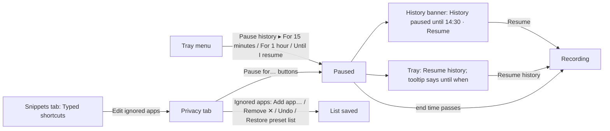

# M1.6 Sensitive-content protection — UI spec

Date: 2026-11-10 — Design note: `docs/design/sensitive-content.md` — Status: draft, waiting for PM

This spec assumes the recommended decisions D1 A (one list), D3 A (pause survives restart) and D4 A (Privacy tab). If the PM chooses otherwise, it is updated before the developer starts.

## User and task

- User: anyone who copies passwords, codes or private text and doesn't want them in history.
- Tasks:
  - Keep copies from a password manager out of history without doing anything, which the preset list covers.
  - Add or remove an app from the ignore list.
  - Stop history for a while ("I'm about to copy my bank details"), and start it again.
- Success:
  - Pausing from the tray takes 2 clicks and under 5 seconds.
  - The user can always see that history is paused and until when, in the tray menu, the tooltip and the History tab.
  - Resume is one action in each place.
  - Everything works with keyboard only, VoiceOver and Narrator.

## Flow



## Layout

Main window with a third tab. The window size is unchanged.

```
┌ Kusunga ─────────────────────────────────────────────┐
│ [ History ] [ Snippets ] [ Privacy ]                 │
│ Pause history                                        │
│ Stop adding copies to history for a while.           │
│ [For 15 minutes] [For 1 hour] [Until I resume]       │
│                                                      │
│ Ignored apps                                         │
│ Copies from these apps aren't kept, and typed        │
│ shortcuts don't work in them.                        │
│   1Password ✕   Bitwarden ✕   KeePassXC ✕            │
│   [Add app…]  [Restore preset list]                  │
│ Kusunga also skips anything an app marks as private. │
└──────────────────────────────────────────────────────┘
```

While paused, the Pause history area reads:

```
│ Pause history                                        │
│ ● Paused until 14:30.                    [Resume]    │
```

History tab banner while paused (reuses `_Banner`, above the list):

```
│ ⏸ History paused until 14:30. New copies aren't kept. [Resume] │
```

Typed shortcuts section (Snippets tab): the status line keeps "On · Skipped in password fields and these apps:" with the chips, and gains a text button "Edit ignored apps" that opens the Privacy tab with focus on the list. The chips there stay read-only (no ✕); editing happens in one place.

## States matrix

| Screen / component | Default | Hover | Focus | Disabled | Loading | Empty | Error | Success | Long content | Offline | Permission denied |
|---|---|---|---|---|---|---|---|---|---|---|---|
| Privacy tab | Pause history and Ignored apps sections, headings "Pause history", "Ignored apps" | Tab `surfaceHover` | Focus ring on the tab; Ctrl+Tab cycles tabs as today | n/a | n/a | n/a | n/a | n/a | Scrolls vertically; no sideways scroll | n/a — no network | n/a |
| Pause buttons (not paused) | Three buttons: "For 15 minutes", "For 1 hour", "Until I resume" | `surfaceHover` | Focus ring | Memory-only mode: still enabled; a note "Pause won't last after Kusunga quits." | n/a (instant) | n/a | Setting not saved: note as Disabled; native call failed: "Couldn't apply the pause. Try again." under the buttons, buttons stay | Area switches to the paused state; focus moves to Resume; announced "History paused until 14:30" | n/a | n/a | n/a |
| Paused state (Privacy tab) | "Paused until 14:30." or "Paused until you resume." + Resume button | Resume `surfaceHover` | Focus ring on Resume | n/a | n/a | n/a | Resume failed: "Couldn't resume. Try again." | Area returns to the three buttons; focus to "For 15 minutes"; announced "History resumed" | Time uses the system 12/24-hour format; date added if the end is not today ("until tomorrow 00:10") | n/a | n/a |
| History banner (paused) | "History paused until 14:30. New copies aren't kept." / "History paused. New copies aren't kept." + Resume | Resume hover | Resume is in tab order before the list | n/a | n/a | n/a | As above | Banner goes away; announced "History resumed" | Wraps to two lines at narrow widths | n/a | n/a |
| Tray menu | Not paused: Open picker · Open Kusunga · Pause history ▸ (For 15 minutes · For 1 hour · Until I resume) · Quit. Paused: Open picker · Open Kusunga · Resume history · Quit | OS default | OS keyboard navigation | n/a | n/a | n/a | Pause failed: the menu keeps "Pause history ▸"; the History tab shows the error the next time it opens | Menu changes to "Resume history"; icon gets its paused variant | n/a | n/a | n/a |
| Tray tooltip | "Kusunga" | n/a | n/a | n/a | n/a | n/a | n/a | Paused: "Kusunga — history paused until 14:30" / "Kusunga — history paused" | n/a | n/a | n/a |
| Ignored apps list | Moved from M1.5 unchanged: chips with ✕, Add app…, Restore preset list, toasts, Undo; copy changed as in Copy | As M1.5 | As M1.5 | n/a — always shown (no longer hidden when typed shortcuts are off) | As M1.5 | "No apps. Kusunga still skips anything an app marks as private." | As M1.5 | As M1.5 | As M1.5 (ellipsis at 30 characters, chip width limited) | n/a | n/a |
| "Edit ignored apps" link (Snippets tab) | Text button after the chips | Underline | Focus ring | Hidden while typed shortcuts are off (as the chips) | n/a | n/a | n/a | Opens the Privacy tab; focus on the "Ignored apps" heading | n/a | n/a | n/a |

## Breakpoints

- **320 px** (stand-in: 360 px window at 200% text): the tab strip wraps to two rows if needed; the three pause buttons stack; banner text wraps and Resume moves below it; chips wrap. No sideways scrolling.
- **360–599 px:** pause buttons on one row when they fit.
- **≥ 600 px:** the layout above.
- **Picker:** unchanged. It has no Privacy tab and shows no banner.

## Accessibility notes

- **Headings and landmarks:** "Pause history" and "Ignored apps" are headings in the Privacy tab panel. The tab is named "Privacy".
- **Focus order:** tabs → pause buttons (or Resume) → ignored-app chips' Remove buttons → Add app… → Restore preset list. In the History tab, the banner's Resume comes before the list. Nothing covers the focused element; toasts sit away from the section.
- **Accessible names:**
  - the buttons: "Pause history for 15 minutes", "Pause history for 1 hour", "Pause history until I resume", "Resume history";
  - chips as M1.5: "Remove 1Password from ignored apps".
- **Announcements:** pausing and resuming are announced once each (polite live region), including when a timed pause ends while Kusunga is open ("History resumed").
- **Targets:** at least 24 × 24 px.
- **Motion:** no new animation.
- **Contrast:** the banner reuses `bannerWarnBg` / `bannerWarnText` (checked in M1.2). Text 4.5:1, controls 3:1, in light and dark.
- **Tray:** the menu is native, so VoiceOver and Narrator read it. The paused state is in the menu text and tooltip, not only in the icon.

## Copy

- Tab: "Privacy".
- Pause section:
  - heading "Pause history";
  - text "Stop adding copies to history for a while.";
  - buttons "For 15 minutes", "For 1 hour", "Until I resume";
  - paused text "Paused until {time}." / "Paused until you resume.";
  - button "Resume";
  - notes "Pause won't last after Kusunga quits." (memory only), "Couldn't apply the pause. Try again.", "Couldn't resume. Try again."
- Banner: "History paused until {time}. New copies aren't kept." / "History paused. New copies aren't kept." Button "Resume".
- Tray:
  - "Pause history" with "For 15 minutes", "For 1 hour" and "Until I resume";
  - "Resume history";
  - tooltip "Kusunga — history paused until {time}" / "Kusunga — history paused".
- Ignored apps:
  - heading "Ignored apps";
  - text "Copies from these apps aren't kept, and typed shortcuts don't work in them.";
  - footer "Kusunga also skips anything an app marks as private.";
  - empty "No apps. Kusunga still skips anything an app marks as private.";
  - the rest is M1.5 copy unchanged ("Add app…", "Restore preset list", "Choose an app", "Search apps…", "Added", toasts).
- Snippets tab link: "Edit ignored apps".
- Announcements: "History paused until {time}", "History paused", "History resumed".

No deceptive patterns: pausing and resuming are equally easy, the paused state is always visible, and nothing is paused by default.

## Tokens used

Existing tokens only: `surface`, `surfaceHover`, `text`, `textMuted`, `border`, `focus`, `bannerWarnBg`, `bannerWarnText`, `space`, `radius2`, `body`, `caption`, `title`. The paused tray icon is a new asset (template image on Mac, `.ico` on Windows) made from the current icon plus a pause mark.
