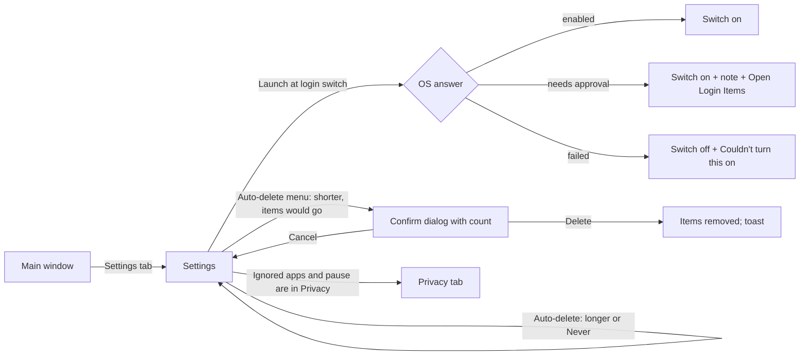

# M1.7 Settings and expiry — UI spec

Date: 2026-11-10 — Design note: `docs/design/settings-and-expiry.md` — Status: approved by PM 2026-11-11

Built on the PM's decisions of 2026-11-11: D1 A, D2 A, D3 B, D4 B, D5 A (the recommended options).

## User and task

- **User:** anyone who uses Kusunga every day.
- **Tasks:**
  - find every setting in one place;
  - have old history removed by itself after a time they choose;
  - start Kusunga when they log in.
- **Success:**
  - each setting is reached in 2 actions from the main window (the Settings tab, then the control);
  - a shorter auto-delete time never deletes without saying how many items will go;
  - the launch-at-login switch always matches the OS.

## Flow



## Layout

```
┌ Kusunga ─────────────────────────────────────────────┐
│ [ History ] [ Snippets ] [ Privacy ] [ Settings ]    │
│ General                                              │
│ Launch at login                              [  ○]   │
│ Start Kusunga in the menu bar when you log in.       │
│ Picker shortcut: ⇧⌘V                     [Change]    │
│                                                      │
│ History                                              │
│ Keep [ 200 ] items                                   │
│ Auto-delete  [ After 30 days ▾ ]                     │
│ Items you haven't copied for this long are removed.  │
│ Snippets are never removed.                          │
│ Ignored apps and pause are in Privacy                │
└──────────────────────────────────────────────────────┘
```

- On Windows the help text reads "Start Kusunga in the tray when you sign in."
- The History tab keeps its header, the count line ("200 of 200 items") and the ⋯ menu.
- The History tab loses the Keep field and the picker shortcut row, which move here unchanged.

## States matrix

| Screen / component | Default | Hover | Focus | Disabled | Loading | Empty | Error | Success | Long content | Offline | Permission denied |
|---|---|---|---|---|---|---|---|---|---|---|---|
| Settings tab | Sections "General" and "History" | Tab `surfaceHover` | Focus ring; Tab reaches the tabs, Left and Right move to the previous or next tab and show it, Enter or Space shows the focused tab, as the M1.6 Privacy tab (no Ctrl+Tab) | n/a | n/a | n/a | n/a | n/a | Scrolls vertically | n/a — no network | n/a |
| Launch at login switch | Off (AC2) | `surfaceHover` | Focus ring | macOS 12: off and disabled, note "Needs macOS 13 or later." (D4 B) | While the OS call runs: the switch keeps its new position, with no spinner (the call is fast); input is ignored until it returns. A login-item call with no answer within 2 s counts as failed (the M1.6 native-call limit); after a failed change the read of the OS state is part of the same call, so input is ignored for at most 4 s. A new change starts clean: an earlier "Couldn't turn this on/off" note goes away while it runs | n/a | After any failed change Kusunga reads the OS state again and the switch shows what it says · Failed turn-on: switch back off, note "Couldn't turn this on. Try again." · Failed turn-off while the OS still has it on: switch stays on, note "Couldn't turn this off. Try again." · If that read fails too, the switch stays where it was: a failed turn-on stays off and a failed turn-off stays on, each with its note (PM decision 2026-11-11, "Where it was") · Mac needs approval: switch on, note "Allow Kusunga in System Settings › General › Login Items." + button "Open Login Items" · Windows disabled in Task Manager: switch off, note "Turned off in Task Manager." | Switch on; announced "Launch at login on" / "off" | n/a | n/a | Mac approval state as Error |
| Picker shortcut row | As M1.3, moved | As M1.3 | As M1.3 | As M1.3 | As M1.3 | n/a | As M1.3 | As M1.3 | n/a | n/a | n/a |
| Keep field | As M1.2, moved, including its confirm dialog | As M1.2 | As M1.2 | As M1.2 | As M1.2 | n/a | As M1.2 | As M1.2 | n/a | n/a | n/a |
| Auto-delete menu | New installs "After 30 days"; existing data "Never" (D3 B) | `surfaceHover` | Focus ring; arrow keys move in the open menu | n/a | n/a | n/a | Save failed: the menu goes back to the old value, "Couldn't save. Try again." below | Longer or Never: saved, no toast · shorter with 0 items to go: saved, no dialog · shorter with items to go: confirm dialog | n/a | n/a | n/a |
| Confirm dialog (shorter time) | "Delete items after 1 day? 143 older items will be deleted. Snippets aren't affected." [Cancel] [Delete] | Button hover | Focus on Cancel first | Count unreadable: "Couldn't count the items. Try again.", only Cancel works (as the limit dialog) | n/a | Count 0 at open: no dialog | Delete failed: dialog closes, toast "Couldn't delete. Try again.", old setting kept | Toast "143 items deleted" | Count follows live changes, as the limit dialog | n/a | n/a |
| Clean-up keeps failing (3 runs) | — | — | — | — | — | — | Warning banner in History (`_Banner`, `bannerWarnBg`): "Couldn't remove old items. Kusunga will try again." | Banner goes away after the next good run | — | — | — |
| "Ignored apps and pause are in Privacy" link | Text button | Underline | Focus ring | n/a | n/a | n/a | n/a | Opens the Privacy tab, focus on "Pause history" heading | n/a | n/a | n/a |
| "Change in Settings" (History, in the banner "Kusunga's shortcut … is used by another app. Choose another.") — PM decision 2026-11-11 | Text button in the banner, `bannerWarnText` | Button hover | Focus ring (3:1 on `bannerWarnBg`) | n/a | n/a | n/a | n/a | Opens the Settings tab, focus on the picker shortcut's Change | Moves below the banner text when they don't fit on one row | n/a | n/a |
| Started at login (D5 A) | No window; the menu-bar or tray icon only | n/a | n/a | n/a | n/a | n/a | Mac can't tell it was a login start: the window opens as today | n/a | n/a | n/a | n/a |

## Breakpoints

- **320 px** (stand-in: 360 px window at 200% text): help text wraps under each control; the switch stays on the right of its label; the menu takes the full width under "Auto-delete". No sideways scrolling.
- **360–599 px:** as 320 px, but label and control share a row when they fit.
- **≥ 600 px:** the layout above.
- **Picker:** unchanged.

## Accessibility notes

- **Headings:** "General" and "History" are headings in the Settings panel.
- **Focus order:**
  1. the tabs;
  2. Launch at login, then "Open Login Items" when it shows;
  3. Change shortcut;
  4. Keep;
  5. Auto-delete;
  6. the Privacy link.
- **Accessible names:**
  - "Launch at login", a switch with an on/off state;
  - "Auto-delete history", whose value is the chosen option;
  - "Change in Settings", a button in the History banner for a taken shortcut;
  - each note is read with its control, as its description.
- **Announcements (polite):**
  - "Launch at login on" and "Launch at login off";
  - "143 items deleted";
  - the error notes when they appear.
- **Targets:** at least 24 × 24 px.
- **Motion:** none new.
- **Contrast:** existing tokens only. Text 4.5:1, controls 3:1, in light and dark.

## Copy

- Tab "Settings". Headings "General" and "History".
- Launch at login:
  - label "Launch at login";
  - help "Start Kusunga in the menu bar when you log in." (Windows: "Start Kusunga in the tray when you sign in.");
  - notes "Needs macOS 13 or later.", "Couldn't turn this on. Try again.", "Couldn't turn this off. Try again.", "Allow Kusunga in System Settings › General › Login Items.", "Turned off in Task Manager.";
  - button "Open Login Items".
- Auto-delete:
  - label "Auto-delete";
  - options "Never", "After 1 day", "After 7 days", "After 30 days";
  - help "Items you haven't copied for this long are removed. Snippets are never removed.";
  - error "Couldn't save. Try again."
- Confirm dialog:
  - "Delete items after {1 day / 7 days / 30 days}? {n} older {item/items} will be deleted. Snippets aren't affected.";
  - buttons "Cancel" and "Delete";
  - toasts "{n} items deleted" and "Couldn't delete. Try again."
- Banner: "Couldn't remove old items. Kusunga will try again."
- Link: "Ignored apps and pause are in Privacy".
- History banner for a taken picker shortcut: button "Change in Settings" (opens the Settings tab with the focus on Change).

No deceptive patterns: the most private login choice is the default, a deletion always says how many items it removes, and turning anything off is as easy as turning it on.

## Tokens used

Existing tokens only: `surface`, `surfaceHover`, `text`, `textMuted`, `border`, `focus`, `bannerWarnBg`, `bannerWarnText`, `space`, `radius2`, `body`, `caption`, `title`.
