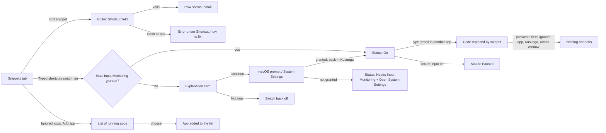

# M1.5 Typed shortcuts — UI spec

Date: 2026-11-08 — Design note: `docs/design/typed-shortcuts.md` — Status: approved by PM 2026-11-08

## User and task

- User: someone who pastes the same few snippets many times a day, such as their email address or phone number.
- Tasks:
  - Give a snippet a short code.
  - Turn typed shortcuts on, understanding what Kusunga watches.
  - Type the code in any app to get the snippet.
  - Keep Kusunga quiet in some apps.
  - Turn it all off in one step.
- Success:
  - Setting a shortcut takes under 15 seconds.
  - Turning the feature on, including the Mac permission, takes under 1 minute.
  - Typing a shortcut pastes the snippet within 150 ms.
  - There are no replacements in password fields or ignored apps.
  - Everything works with keyboard only and with VoiceOver and Narrator.

## Flow



## Layout

Snippets tab, with a new section above the list. The window size is unchanged.

```
┌ Kusunga ───────────────────────────────────────────┐
│ [ History ] [ Snippets ]              [+ New snippet]│
│ Typed shortcuts                         [  ●○ Off ] │
│ Type a snippet's shortcut, like ;email, in any app  │
│ to paste it.                                        │
│ ● On · Skipped in password fields and these apps:   │
│   1Password  ✕   Bitwarden  ✕   KeePassXC  ✕        │
│   [Add app…]  [Restore preset list]                 │
│ ┌────────────────────────────────────────────────┐ │
│ │ ✉  Work email   ;email   will@example.com      │ │
│ │ ☎  My mobile    ;mob     07700 900123          │ │
│ └────────────────────────────────────────────────┘ │
│ 2 snippets                                          │
└─────────────────────────────────────────────────────┘
```

Editor, with a new optional field after Type:

```
│ Name      [ Work email                  ] │
│ Type      [ Email ▾ ]                     │
│ Shortcut  [ ;email        ] (optional)    │
│           Type this in any app to paste.  │
│ Content   [ will@example.com            ] │
```

Explanation card (Mac, shown before the macOS prompt):

```
┌ Turn on typed shortcuts? ─────────────────────────┐
│ To notice your shortcuts, Kusunga needs the       │
│ Input Monitoring permission.                      │
│ • Kusunga keeps only the last few characters you  │
│   type, for 5 seconds, in memory. It never saves  │
│   or sends them.                                  │
│ • Password fields and the apps you list are       │
│   always skipped.                                 │
│ • You can turn this off at any time.              │
│                        [Not now]  [Continue]      │
└───────────────────────────────────────────────────┘
```

## States matrix

| Screen / component | Default | Hover | Focus | Disabled | Loading | Empty | Error | Success | Long content | Offline | Permission denied |
|---|---|---|---|---|---|---|---|---|---|---|---|
| Typed shortcuts switch | Off (D3 A). Label "Typed shortcuts"; the state is in text ("Off" / "On") as well as the switch | `surfaceHover` | Focus ring; Space toggles | In memory-only or incompatible mode, with the reason in the status line | n/a | n/a | Can't start: status line (see below); the switch stays on so the user can retry by turning it off and on | Status "On" | n/a | n/a — no network | Mac: turning it on without permission opens the explanation card |
| Status line | Hidden while off. "On · Skipped in password fields and these apps:" | n/a | Not focusable; changes are announced (polite) | n/a | "Starting…" only if > 300 ms | n/a | "Couldn't start typed shortcuts." (Windows hook) / "Typed shortcuts stopped. Turn them off and on again." (tap failed) / "Typed shortcuts are off because snippets can't be opened right now." | "On" | Wraps | n/a | "Needs Input Monitoring. Kusunga can't see your shortcuts until you allow it." [Open System Settings]. Paused: "Paused while another app protects your typing." |
| Explanation card (Mac) | Shown each time the switch is turned on without permission (PM, 2026-11-08) | Buttons hover | Dialog; focus on "Continue"; Tab stays inside; Esc = "Not now" and focus goes back to the switch | n/a | n/a | n/a | n/a | Continue: the macOS prompt shows, or System Settings opens if macOS has stopped asking | n/a | n/a | "Not now": the switch goes back to Off |
| Ignored apps list | Preset password managers as chips, each with a Remove ✕ | Chip `surfaceHover` | Each chip's ✕ is focusable: "Remove 1Password" | Hidden while the switch is off | n/a | "No apps. Kusunga still skips password fields." | Save fails: toast "Couldn't update the list. Try again." | Toast "1Password removed" + Undo (5 s); Undo puts the app back at the end of the list (PM, 2026-11-08) | Chips wrap; names over 30 characters end with an ellipsis, and the full name is in the accessible name | n/a | n/a |
| Add app… | Button | Hover | Focus ring | n/a | "Finding apps…" if > 300 ms | "No other apps are open. Open the app, then try again." | n/a | Opens a list of running apps (name and icon), searchable by name; Enter adds; already-listed apps are shown as "Added" and can't be chosen; no Cancel button: Esc or a click outside closes it (PM, 2026-11-08) | Names cut with an ellipsis | n/a | n/a |
| Restore preset list | Text button, shown only when a preset app was removed | Hover | Focus ring | n/a | n/a | n/a | As the list | Toast "Preset list restored" | n/a | n/a | n/a |
| Editor Shortcut field | Empty, optional. Hint "Type this in any app to paste." Placeholder ";email" | `borderHover` | Focus ring; Tab order Name → Type → Shortcut → Content → Cancel → Save | Memory-only, as the editor | n/a | Empty = no shortcut | Under the field, linked to it (see Copy). Checked as the user types (after 500 ms) and on Save; focus goes to it if Save finds an error | Row shows the shortcut | 32 characters max; the field refuses more | n/a | n/a |
| Snippet list row | Shortcut after the name in `textMuted` monospace, or nothing | As M1.4 | Accessible name adds "shortcut ;email" | As M1.4 | As M1.4 | As M1.4 | As M1.4 | As M1.4 | The shortcut is never cut | n/a | n/a |
| Picker snippet row | "Name ;email — content" | As M1.4 | Announced "1, Email, Work email, shortcut ;email, will@example.com" | n/a | n/a | n/a | n/a | n/a | As M1.4 | n/a | n/a |
| Replacement (in another app) | The code disappears and the snippet appears | n/a | Focus stays in the user's field | Skipped silently in password fields, ignored apps, Kusunga itself, admin windows, and when keys come from software (D5 A) | n/a | n/a | Paste fails: M1.3 toast "Copied. Press ⌘V to paste." (Windows "Ctrl+V") | n/a | Long snippets paste in one step | n/a | Paste permission missing: as M1.3 |

## Breakpoints

- **320 px** (stand-in: 360 px window at 200% text): the section title and switch stay on one row. The description, status and chips wrap. Add app and Restore stack. The explanation card fills the window. No sideways scrolling.
- **360–599 px:** as above, with the buttons on one row when they fit.
- **≥ 600 px:** the layout above. The explanation card is a 440 px dialog.
- **Picker:** unchanged from M1.4. The shortcut is dropped before the name is cut, under 400 px.

## Accessibility notes

- **Headings and landmarks:** "Typed shortcuts" is a heading in the Snippets tab panel. The explanation card is a dialog named "Turn on typed shortcuts?".
- **Switch:** it has the role switch, the name "Typed shortcuts" and its state. The status line is a polite live region, and changes are announced once and not repeated.
- **Focus order and keyboard paths:** switch → Open System Settings (when shown) → ignored-app chips' Remove buttons → Add app… → Restore preset list → the list. Nothing covers the focused element, and the toasts sit away from the section.
- **Accessible names:**
  - "Remove 1Password from ignored apps";
  - "Add an app to ignore";
  - rows: "Work email, Email, shortcut ;email, will@example.com".
- **Form labels and errors:** Shortcut has a visible label, and "(optional)" is in the label text. Errors are linked to the field. Paste is allowed.
- **Screen readers in other apps:** after a replacement, the target app's own screen reader text applies. VoiceOver and Narrator modifier keys (⌃⌥, Caps Lock / Insert) reset the buffer, so screen reader commands never fire a shortcut.
- **Targets:** at least 24 × 24 px. The chip ✕ is 24 px, and the switch is 40 × 24 px.
- **Motion:** the switch animation is off when reduce motion is on.
- **Contrast:** 4.5:1 for the status and shortcut text (`textMuted` on `surface`) and 3:1 for the switch track, in light and dark.

## Copy

- Section:
  - Title: "Typed shortcuts".
  - Description: "Type a snippet's shortcut, like ;email, in any app to paste it."
  - Switch states: "On" / "Off".
- Status:
  - "On · Skipped in password fields and these apps:"
  - "Starting…"
  - "Needs Input Monitoring. Kusunga can't see your shortcuts until you allow it." [Open System Settings]
  - "Paused while another app protects your typing."
  - "Couldn't start typed shortcuts."
  - "Typed shortcuts stopped. Turn them off and on again."
  - "Typed shortcuts are off because snippets can't be opened right now."
- Ignored apps:
  - "Add app…" and "Restore preset list".
  - Empty: "No apps. Kusunga still skips password fields."
  - Add-app list: title "Choose an app"; search placeholder "Search apps…"; "Added"; empty: "No other apps are open. Open the app, then try again."
  - Toasts: "1Password removed" [Undo]; "Preset list restored"; "Couldn't update the list. Try again."
- Explanation card:
  - Title: "Turn on typed shortcuts?"
  - Text: "To notice your shortcuts, Kusunga needs the Input Monitoring permission."
  - Bullets:
    - "Kusunga keeps only the last few characters you type, for 5 seconds, in memory. It never saves or sends them."
    - "Password fields and the apps you list are always skipped."
    - "You can turn this off at any time."
  - Buttons: "Not now", "Continue".
- Editor Shortcut field:
  - Label: "Shortcut (optional)".
  - Hint: "Type this in any app to paste."
  - Placeholder: ";email".
  - Errors:
    - "Use 2 to 32 characters."
    - "Shortcuts can't have spaces or line breaks."
    - "“Work email” already uses ;email. Choose another shortcut."
    - New shortcut starts with an existing one (D1 A): "“Work email” uses ;em, so ;email would never fire. Choose one that doesn't start with ;em."
    - An existing shortcut starts with the new one (D1 A): "“Work email” uses ;email, which starts with ;em, so ;email would stop firing. Choose a longer or different shortcut."
  - Tip, shown under the hint when the shortcut is all letters: "Tip: start with a symbol like ; so normal typing doesn't trigger it."

No deceptive patterns: the feature is off until the user turns it on, "Not now" is as easy as "Continue", and turning it off is one switch.

## Tokens used

Existing tokens only (`lib/theme/tokens.dart`): `surface`, `surfaceHover`, `text`, `textMuted`, `border`, `borderHover`, `focus`, `danger`, `bannerWarnBg`, `bannerWarnText`, and the `space`, `radius2`, `body`, `caption` and `title` styles. Shortcuts use the existing monospace text style if there is one; otherwise the developer adds a `mono` style built from `caption`, which is the only new token. No hard-coded values.
