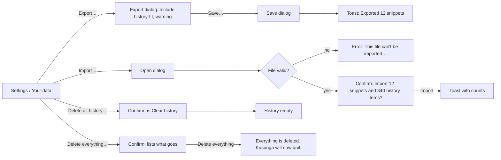

# M1.8 Your data — UI spec

Date: 2026-11-12 — Design note: `docs/design/your-data.md` — Status: approved by PM 2026-11-12

Built on the PM's decisions of 2026-11-12: D1 A, D2 A, D3 A, D4 A, D5 A, D6 A (the recommended options), and the lead's rulings of 2026-11-12 during the build (G2, G4, G5).

## User and task

- **User:** anyone who wants a copy of their snippets, is moving to a new computer, or wants Kusunga to forget everything.
- **Tasks:**
  - save snippets (and, if they choose, history) to a file;
  - bring that file back on this or another computer;
  - delete all history, or delete everything Kusunga holds.
- **Success:**
  - export in 3 actions: Export…, Save, then pick a place;
  - import never changes what is already there;
  - nothing is deleted without a question that says exactly what goes.

## Flow



## Layout

A new section at the end of the Settings tab:

```
│ Your data                                            │
│ [Export…]  [Import…]                                 │
│ Export saves your snippets, and history if you       │
│ choose, to a file. The file isn't encrypted.         │
│                                                      │
│ [Delete all history…]  [Delete everything…]          │
│ Delete everything removes all Kusunga data from      │
│ this computer, including its key.                    │
```

**Export dialog:**

```
┌ Export your data ───────────────────────────┐
│ Your snippets and settings will be saved     │
│ to a file.                                   │
│ ☐ Include history (200 items)                │
│ The file isn't encrypted. Anyone who opens   │
│ it can read it.                              │
│                         [Cancel] [Save…]     │
└──────────────────────────────────────────────┘
```

**Import confirm:**

```
┌ Import from kusunga-export-2026-11-12.json ─┐
│ Import 12 snippets and 340 history items?    │
│ Nothing you have now will be changed or      │
│ removed.                                     │
│ ☐ Also use the settings in this file         │
│                         [Cancel] [Import]    │
└──────────────────────────────────────────────┘
```

**Delete everything confirm:**

```
┌ Delete everything? ─────────────────────────┐
│ This removes from this computer:             │
│ • all history (200 items)                    │
│ • all snippets (12)                          │
│ • your settings and ignored apps             │
│ • Kusunga's key and log                      │
│ Launch at login is turned off, and Kusunga   │
│ quits. This can't be undone. Export first if │
│ you want a copy.                             │
│                [Cancel] [Delete everything]  │
└──────────────────────────────────────────────┘
```

The "Delete everything" button uses the destructive style already used by Clear history.

## States matrix

| Screen / component | Default | Hover | Focus | Disabled | Loading | Empty | Error | Success | Long content | Offline | Permission denied |
|---|---|---|---|---|---|---|---|---|---|---|---|
| Your data section | Four buttons and two help lines | `surfaceHover` | 2 px `focus` ring | Delete all history disabled when history is empty | n/a | No snippets and no history: Export still works (exports settings) | n/a | n/a | Buttons wrap at narrow widths | n/a | n/a |
| Export dialog | Include history unticked (D2 A); focus on Cancel | Button hover | Tab order: tick box, Cancel, Save… | Include history disabled, "(no items)", when history is empty | While writing: Save… shows "Saving…", input ignored | — | Write failed: dialog stays, "Couldn't save the export. Try again." | Toast "Exported 12 snippets" / "Exported 12 snippets and 200 history items" | Counts use the item/items rule | n/a | Mac save dialog cancelled: nothing happens, no message |
| Import (open dialog) | OS dialog filtered to `.json` | OS | OS | Import… disabled while history isn't saved (memory only, incompatible, backup failed), with the line "Import isn't available right now, because history isn't being saved." (G2) | While the dialog is open and the file is checked: the Import… button reads "Checking the file…" and is disabled (G4) | — | Refused: a toast, "This file can't be imported. It isn't a Kusunga export, or it is damaged." (G4) | Opens the confirm | n/a | n/a | Cancelled: nothing happens |
| Import confirm | Counts from the file (history: only the items that will be added, G5); settings tick box unticked; focus on Cancel | Button hover | Tab order: tick box, Cancel, Import | Settings tick box hidden when the file has no settings | "Importing…" | File with 0 snippets and 0 history: "This file has nothing to import." and only Close | Write failed: "Couldn't import. Nothing was changed." | Toast with counts and skips (see Copy) | Long file name shortened in the middle | n/a | n/a |
| Delete all history | As Clear history (M1.2) | — | — | Disabled when empty | — | — | As Clear history | As Clear history | — | n/a | n/a |
| Delete everything confirm | Lists counts; focus on Cancel | Button hover | Cancel first | n/a | "Deleting…", input ignored (up to 90 s if the keychain doesn't answer, T5) | Counts may be 0; the list still shows | Key delete failed: dialog stays, "Couldn't delete everything. Nothing was deleted. Try again." Keychain never answered (T5): the stuck note (see Copy), announced, with one OK (focused) that quits; Escape quits too; no Cancel or Try again; recording stays stopped | "Everything is deleted. Kusunga will now quit." with one OK, then quit | — | n/a | Mac keychain or Windows credential refused: as Error |
| Memory-only mode | Section shown; help line adds "History isn't saved right now."; Import… disabled with its line (G2) | — | — | — | — | — | — | — | — | — | — |

## Breakpoints

- **320 px** (stand-in: 360 px window at 200% text): the buttons stack one per row, and the dialogs fit with wrapped text. No sideways scrolling.
- **360–599 px:** buttons two per row.
- **≥ 600 px:** the layout above.

## Accessibility notes

- "Your data" is a heading.
- Every dialog is a modal with its title as its name. Focus goes to Cancel, and Escape cancels.
- **The tick boxes:**
  - "Include history" is read with its count;
  - "Also use the settings in this file".
- **Announcements (polite):**
  - the export toast;
  - the import toast;
  - "Checking the file…" only when it takes more than 1 second;
  - errors.
- Targets are at least 24 × 24 px. Existing tokens only. Contrast: text 4.5:1, controls 3:1, in light and dark.

## Copy

- **Section:**
  - heading "Your data";
  - buttons "Export…", "Import…", "Delete all history…", "Delete everything…";
  - help "Export saves your snippets, and history if you choose, to a file. The file isn't encrypted." and "Delete everything removes all Kusunga data from this computer, including its key."
- **Export:**
  - title "Export your data";
  - text "Your snippets and settings will be saved to a file.";
  - tick box "Include history ({n} {item/items})";
  - warning "The file isn't encrypted. Anyone who opens it can read it.";
  - buttons "Cancel" and "Save…";
  - default file name `kusunga-export-YYYY-MM-DD.json`;
  - toasts "Exported {n} {snippet/snippets}" / "Exported {n} {snippet/snippets} and {m} history {item/items}";
  - error "Couldn't save the export. Try again."
- **Import:**
  - "Checking the file…";
  - refused: "This file can't be imported. It isn't a Kusunga export, or it is damaged.";
  - confirm title "Import from {file name}";
  - confirm text "Import {n} {snippet/snippets} and {m} history {item/items}? Nothing you have now will be changed or removed.";
  - tick box "Also use the settings in this file";
  - buttons "Cancel" and "Import";
  - empty "This file has nothing to import." with "Close";
  - toast "Imported {n} {snippet/snippets} and {m} history {item/items}.", followed when they apply by "{k} {snippet was/snippets were} already here.", "{j} {shortcut was/shortcuts were} already used, so {that snippet has/those snippets have} none." and "{h} history {item was/items were} older than your auto-delete time and {wasn't/weren't} added." (G5);
  - when Import is off (G2): "Import isn't available right now, because history isn't being saved.";
  - error "Couldn't import. Nothing was changed."
- **Delete everything:**
  - title "Delete everything?";
  - text "This removes from this computer:", then the bullets "all history ({n} {item/items})", "all snippets ({n})", "your settings and ignored apps" and "Kusunga's key and log";
  - then "Launch at login is turned off, and Kusunga quits. This can't be undone. Export first if you want a copy.";
  - buttons "Cancel" and "Delete everything";
  - done "Everything is deleted. Kusunga will now quit." with "OK";
  - partial "Everything is deleted. {n} {file/files} couldn't be removed, but {it/they} can't be read any more." with "OK";
  - error "Couldn't delete everything. Nothing was deleted. Try again.";
  - stuck, when the keychain never answers (T5; lead's wording, 2026-11-12) "Kusunga couldn't confirm whether its key was deleted, so it has stopped recording and will now quit. Open Kusunga again. If your snippets and history are still there, try Delete everything again." with "OK", which quits.

No deceptive patterns:
- the private choice is the default (history unticked);
- every deletion says what goes;
- Cancel is always first and focused;
- the export warning is shown before the save dialog, not hidden after it.

## Tokens used

Existing tokens only: `surface`, `surfaceHover`, `text`, `textMuted`, `border`, `focus`, `bannerWarnBg`, `bannerWarnText`, `space`, `radius2`, `body`, `caption`, `title`.
